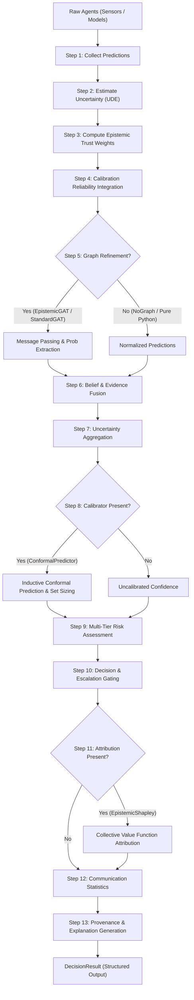

# 🏗️ Architecture & Data Flow

This document details the source-verified internal architecture, data contracts, and execution lifecycle of COGNIX v0.1.0 as implemented in `cognix.engine.pipeline.CognixPipeline` and `cognix.engine.decision_engine.DecisionEngine`.

---

## 1. High-Level Architectural Flow

COGNIX coordinates a 13-stage decision pipeline from raw agent observations to an audited, calibrated `DecisionResult`:



---

## 2. Detailed Execution Lifecycle

Each call to `engine.decide(agents, input_data, context)` executes the following sequential steps:

### Step 1: Collect Predictions
- **Internal Helper**: `_collect_predictions(agents, input_data)`
- **Mechanism**: Iterates over each agent in `agents`. Queries `agent.predict(input_data)` or calls the agent directly if callable. Validates that predictions contain finite numeric values.
- **Fail-Loud Behavior**: In `research` mode, raises `RuntimeError` if no valid predictions are gathered. In `production` mode, returns a safe fallback `ABSTAIN` result.

### Step 2: Estimate Uncertainty (UDE)
- **Internal Helper**: `_estimate_uncertainties(agents, predictions, input_data)`
- **Mechanism**: Queries `agent.estimate_uncertainty(input_data)`. If the agent lacks an estimator, it calls the injected global `uncertainty_estimator` plugin.
- **Values Extracted**: Epistemic uncertainty ($\sigma_e$), aleatoric uncertainty ($\sigma_a$), and total uncertainty ($\sigma_t$).
- **Fail-Loud Behavior**: In `research` mode, missing uncertainty estimators raise `RuntimeError`. In `production` mode, falls back to a documented confidence-derived heuristic.

### Step 3: Compute Trust Weights
- **Internal Helper**: `_compute_trust_weights(uncertainties)`
- **Mechanism**: Calculates dynamic trust weights inversely proportional to each agent's epistemic uncertainty:
  $$w_j = \frac{1}{\sigma_{e, j} + 10^{-8}}$$
- Normalizes weights across all contributing agents: $\sum_j \bar{w}_j = 1$.

### Step 4: Reliability Integration
- **Mechanism**: If `agent_reliabilities` is provided, scales trust weights by each agent's empirical accuracy on a validation split. In `research` mode, logs an audit warning if reliabilities are left at default uniform $1.0$.

### Step 5: Relational Graph Refinement (Optional Extra)
- **Component**: `EpistemicGAT` or `StandardGAT` (requires `[graph]` extra).
- **Mechanism**: Builds node features $[p_j, \sigma_{e, j}, \sigma_{a, j}] \in \mathbb{R}^{N \times 3}$ and a fully connected adjacency matrix. Executes graph attention message passing, adjusting edge weights by epistemic priors. Refined probabilities are extracted via $p_j' = \text{sigmoid}(H'_{j, 0})$.
- **Safety Guard**: Checks `graph.is_trained()`. If untrained, `research` mode raises `RuntimeError`, while `production` mode bypasses graph refinement to prevent random weight contamination.

### Step 6: Belief & Evidence Fusion (M2)
- **Component**: `EpistemicWeightedFusion` or `AverageFusion`.
- **Mechanism**: Combines agent predictions into a collective probability $p_{\text{collective}}$ using normalized trust weights.

### Step 7: Uncertainty Aggregation
- **Mechanism**: Computes weighted aggregates of epistemic uncertainty, aleatoric uncertainty, and total predictive uncertainty across the ensemble.

### Step 8: Post-Hoc Calibration (M3)
- **Component**: `ConformalPredictor` (Inductive Conformal Prediction).
- **Mechanism**: Evaluates the collective confidence against the pre-fitted nonconformity score distribution. Emits the conformal prediction set $C(x)$ and target coverage metadata.
- **Safety Guard**: If uncalibrated, `research` mode raises `RuntimeError`, prompting the user to call `calibrator.fit()`.

### Step 9: Multi-Tier Risk Assessment
- **Internal Helper**: `_assess_risk(fused_confidence, agg_epistemic)`
- **Mechanism**: Classifies risk into `RiskLevel.LOW`, `RiskLevel.MODERATE`, or `RiskLevel.HIGH` by evaluating configurable thresholds defined in `CognixConfig`.

### Step 10: Decision & Escalation Gating
- **Internal Helper**: `_make_decision(...)`
- **Mechanism**: Maps risk level, point confidence, and conformal prediction set cardinality into one of five operational outcomes:
  - `conformal_set_size >= max_conformal_set_size` $\implies$ `DecisionOutcome.ESCALATE`
  - `RiskLevel.HIGH` $\implies$ `DecisionOutcome.ESCALATE`
  - `RiskLevel.MODERATE` $\implies$ `DecisionOutcome.REQUEST_INFORMATION`
  - `RiskLevel.LOW` $\implies$ `DecisionOutcome.ACT`

### Step 11: Attribution & Explainability (M5)
- **Component**: `EpistemicShapley` (requires `[explainability]` extra).
- **Mechanism**: Calculates agent marginal contributions to collective uncertainty reduction using the collective value function $v(S)$.

### Step 12: Communication Statistics
- **Mechanism**: Captures communication message counts, bandwidth utilization, or GAT attention edge statistics.

### Step 13: Structured Explanation & Provenance
- **Internal Helper**: `_generate_explanation(...)`
- **Mechanism**: Generates an auditable list of reasoning steps and a human-readable summary, recording latency metrics for every executed stage in milliseconds.

---

## 3. Data Structures & Contracts

### `DecisionResult`
The output of every pipeline run is a fully populated `DecisionResult` dataclass:

```python
@dataclass
class DecisionResult:
    decision: DecisionOutcome               # ACT, WAIT, REQUEST_INFORMATION, ABSTAIN, ESCALATE
    confidence: float                      # Fused confidence scalar in [0, 1]
    calibrated_confidence: Optional[float] # Conformal or temperature-calibrated confidence
    aleatoric_uncertainty: Optional[float] # Aggregated data noise
    epistemic_uncertainty: Optional[float] # Aggregated model ignorance
    total_uncertainty: float               # Sum of aleatoric and epistemic uncertainty
    risk_level: RiskLevel                  # LOW, MODERATE, HIGH
    escalation_required: bool              # True if safety handoff is required
    abstained: bool                        # True if pipeline abstained from decision
    requested_information: bool            # True if additional observations are needed
    agent_contributions: dict[str, float]  # Shapley attribution values per agent
    agent_trust_weights: dict[str, float]  # Normalized weights used in belief fusion
    agent_predictions: dict[str, float]    # Active predictions per agent
    communication_statistics: Optional[dict]# Network communication overhead
    calibration_metrics: Optional[dict]    # Conformal prediction set, quantile, coverage
    explanation: str                       # Concise human-readable explanation
    reasoning_steps: list[str]             # Step-by-step pipeline audit trail
    latency_ms: dict[str, float]           # Latency breakdown per stage in ms
    total_latency_ms: float                # Total cycle latency in ms
    timestamp: float                       # UNIX timestamp
    session_id: Optional[str]              # Optional session identifier
    metadata: dict[str, Any]               # Additional user or domain metadata
```

### Key Convenience Properties
- **`is_safe_decision`**: Returns `True` only if `not escalation_required and not abstained`.
- **`dominant_uncertainty_source`**: Compares `epistemic_uncertainty` and `aleatoric_uncertainty`, returning `"epistemic"`, `"aleatoric"`, or `"unknown"`.
- **`summary()`**: Returns a one-line formatted status string.
- **`to_dict()`** / **`from_dict()`**: Native serialization for JSON logging and database storage.

---

## 4. Decoupling & Pluggable Architecture

COGNIX enforces strict separation of concerns via abstract interfaces (`cognix.core.interfaces`):

| Interface | Standard Base Implementation | Optional Plugin Extra |
|---|---|---|
| **`AgentInterface`** | `StandardAgent` | Domain-specific sensors or model wrappers |
| **`BeliefFuser`** | `EpistemicWeightedFusion`, `AverageFusion` | Custom Bayesian or Dempster-Shafer fusers |
| **`Calibrator`** | `ConformalPredictor`, `TemperatureScaling` | Multi-class Venn-Abers predictors |
| **`GraphRefinement`** | `NoGraph` (default) | `EpistemicGAT`, `StandardGAT` (`[graph]`) |
| **`AttributionMethod`**| `None` (default) | `EpistemicShapley` (`[explainability]`) |
| **`UncertaintyEstimator`**| `UncertaintyDecomposition` | `MonteCarloDropout`, `DeepEnsemble` |
