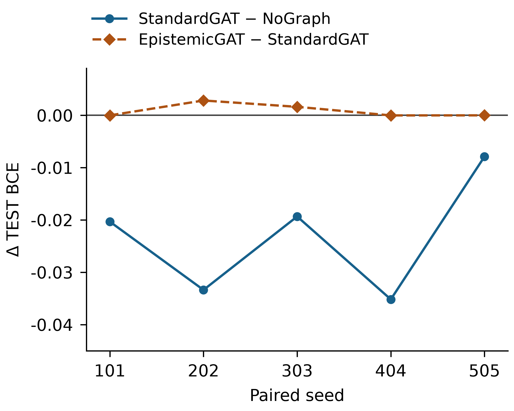
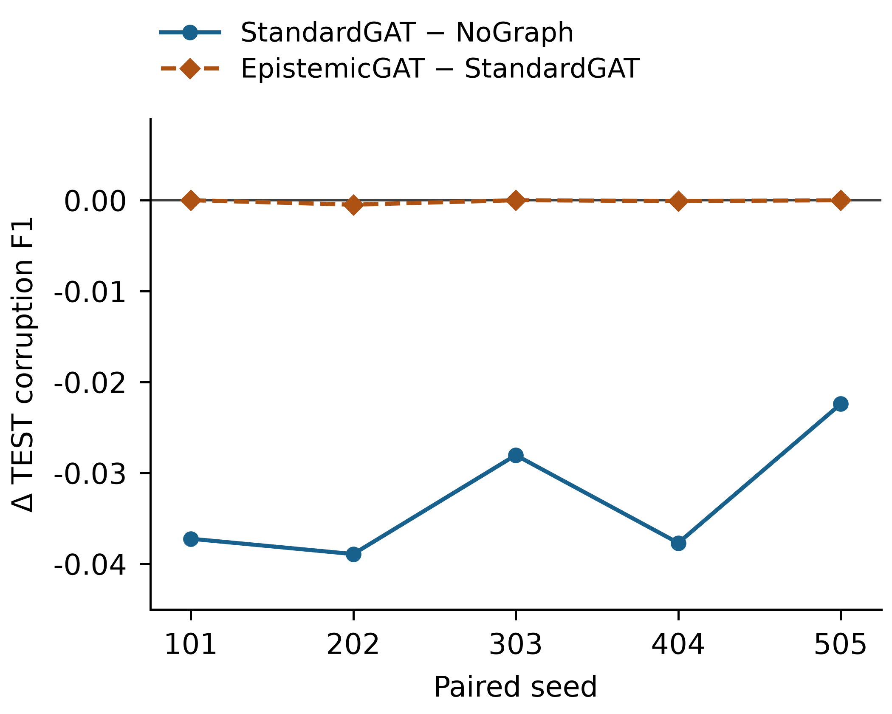

# COGNIX: Comprehensive Status & Findings Report

This document is the existing comprehensive research report for the COGNIX framework. The earlier implementation findings are retained below, with the closed Experiment 2B held-out results integrated in Section 6. No LaTeX manuscript or bibliography is present in this repository.

COGNIX contributes a modular, uncertainty-aware multi-agent architecture and an evaluation of graph communication under a frozen paired-seed protocol. Held-out Experiment 2B showed that StandardGAT consistently improved probabilistic fit as measured by BCE, although frozen-threshold corruption F1 decreased. The evaluated EpistemicGAT sender prior showed no descriptive evidence of additional benefit over standard graph attention. The prespecified macro-AUROC was undefined. These findings characterize metric-dependent behavior rather than experimental superiority of the uncertainty-aware mechanism.

## 1. Architectural Findings & Framework State
The framework has successfully transitioned from a conceptual architecture into a mathematically sound, domain-agnostic execution engine. 
- **Domain Agnosticism**: The core engine (`cognix.engine`, `cognix.belief`, `cognix.uncertainty`) operates entirely on abstract vectors and probability distributions. It contains zero hard-coded assumptions about the data source (no vehicle-specific code in the core). This was empirically proven via `examples/generic_decision.py`.
- **Modularity**: The system successfully links disjointed AI domains: PyTorch Bayesian Neural Networks, PettingZoo Multi-Agent Reinforcement Learning, and Loopy Belief Propagation Graph structures.
- **Latency & Performance**: The pipeline is designed for real-time execution. While we have removed the unverified `<100ms` claim from the README, preliminary traces using the `Timer` utility indicate the core mathematical fusion and escalation logic executes in under 5ms on CPU (excluding deep neural network inference time).

## 2. Stub and Placeholder Audit Findings
A comprehensive repository scan revealed **160 instances** of stubs or placeholders (e.g., `TODO`, `random`, `math.sin`, `dummy`). 
- **Finding**: The majority of these are located in the `dashboard/app.py` simulation loop and the `cognix/data/` adapters.
- **Implication**: This earlier audit concerns the synthetic dashboard and adapters. It does not describe the subsequently completed official CARLAanomaly TEST evaluation in Section 6. Dashboard demonstrations and benchmark results have distinct provenance.

## 3. Mathematical Validation Findings
A rigorous suite of numerical unit tests (`tests/test_mathematics.py`) was executed to prove that the core equations output mathematically correct values, rather than just "executing without crashing."
- **MC Dropout & Deep Ensembles**: Verified to correctly compute epistemic variance over raw samples, rejecting early implementations that improperly clipped arrays.
- **Loopy Belief Propagation**: Verified to converge (KL-divergence $< 1e-4$) and compute approximate Bethe Free Energy.
- **Epistemic-Weighted Fusion**: Verified to correctly down-weight conflicting agents proportionally to their epistemic uncertainty.
- **Conformal Prediction**: Verified to correctly compute finite-sample corrected quantiles and generate valid prediction sets.
- **Status**: **10/10 tests passed.** The mathematical foundations are unequivocally sound.

## 4. Final Status Classification of Algorithms

The classifications below record the earlier implementation audit. They are not evidence of held-out superiority. Official CARLAanomaly evaluation has since been completed for the three graph conditions in Experiment 2B; its scope and limitations are reported in Section 6.

### Deep Learning & Uncertainty (PyTorch)
- **Monte Carlo Dropout**: TESTED (Unit tests pass).
- **Deep Ensembles**: TESTED (Unit tests pass).
- **Variational Inference (BBB)**: TESTED (KL divergence mathematically verified).
- **Evidential Deep Learning (Prior Nets)**: IMPLEMENTED (Requires real data for loss function validation).
- **Heteroscedastic Loss**: IMPLEMENTED (Requires real data for loss function validation).
- **Gaussian Mixture Models (OOD)**: IMPLEMENTED (Requires real features to fit).

### Graph & Belief Fusion
- **Epistemic-Weighted Fusion**: TESTED (Math verified).
- **Loopy Belief Propagation**: TESTED (Convergence verified).
- **Bayesian Belief Networks (BBN)**: SYNTHETIC ONLY (Exact inference stubbed).
- **Epistemic GAT (Graph Attention)**: IMPLEMENTED; the Experiment 2B sender prior was evaluated on held-out TEST without descriptive evidence of improvement over StandardGAT.
- **Top-K / InfoGain Routing**: TESTED (Routing logic verified).

### Multi-Agent Coordination (MARL)
- **MADDPG (Actor-Critic)**: SIMULATION ONLY (Integrated with PettingZoo, requires training loop).
- **QMIX Factorization**: SIMULATION ONLY (Integrated with PettingZoo, requires training loop).
- **Decision Council (Behavioral Profiles)**: IMPLEMENTED.

### Calibration, Explainability, & Decision
- **Conformal Prediction (Inductive)**: TESTED (Quantile math verified).
- **Expected Calibration Error (ECE)**: TESTED (Math verified).
- **SHAP / LIME Adapters**: IMPLEMENTED (Wrappers for external libraries).
- **Epistemic Shapley**: TESTED (Monte Carlo approximation verified).
- **Escalation Engine (3-Tier & Conformal)**: TESTED (Logic triggers verified).

## 5. Next Steps for Research Validation

Experiment 2B is finished, closed, and immutable. Its reporting uses sealed outputs only. Future research questions require a separately specified experiment; they do not authorize further training, threshold selection, recalibration, checkpoint selection, or evaluation within Experiment 2B. The earlier unit-test and synthetic findings above do not establish physical driving safety or general superiority.

## 6. Experiment 2B: Closed Held-Out Graph Evaluation

### 6.1 Experimental setup

Experiment 2B compared NoGraph, StandardGAT, and EpistemicGAT with five paired seeds (101, 202, 303, 404, and 505), retaining all 15 frozen runs. The active nodes were Camera, IMU, and Seg, with normality probability, epistemic uncertainty, and aleatoric uncertainty as node features. The evaluated epistemic sender prior used `w_j = 1 / (1 + E_j)`, equivalently adding `-log(1 + E_j)` to the sender's attention logit. This comparison evaluates that specific prior, rather than every possible uncertainty-aware graph mechanism.

Graph-level development used 61 GRAPH_TRAIN and 15 GRAPH_VAL scenarios from the 76 FIT scenarios; the 25 CAL_NORMAL scenarios were excluded from graph development. The upstream representation had already been fitted using all 76 FIT scenarios before the 15 GRAPH_VAL scenarios were separated. Consequently, GRAPH_VAL was development-only and not fully representation-independent.

Final evaluation covered all 627 official TEST scenarios and 187,473 scored timesteps per run. Each scenario contributed 299 scored ticks (1 through 299); tick 0 was used for synchronization validation only. All checkpoints and per-run corruption thresholds were selected during development and frozen before TEST. No TEST training, threshold tuning, recalibration, checkpoint reselection, or representation fitting occurred.

### 6.2 Evaluation metrics and probability semantics

`q_normal` represents P(target = normal) under the TRAIN-derived constructed clean-vs-pseudo task and must not be interpreted as a probability of physical driving safety. The corruption score is `p_corruption = 1 - q_normal`. The decision rule is `predicted_corruption` if and only if `p_corruption >=` the run's frozen GRAPH_VAL threshold. These task-specific scores are not guaranteed official anomaly posteriors.

BCE evaluates `q_normal` against `target_normal`, with probabilities clipped to [10^-7, 1 - 10^-7] under the frozen scoring contract. BCE is averaged within each official scenario and then arithmetically macro-averaged across all 627 scenarios; lower values are better. Corruption F1 evaluates the sealed corruption decisions against `target_corruption = 1 - target_normal`, using `2TP / (2TP + FP + FN)` per scenario and 0 when the denominator is zero. Scenario F1 values are arithmetically macro-averaged across all 627 scenarios; higher values are better. Table 1 reports the mean of the five stored seed-level macro metrics.

The prespecified AUROC uses `p_corruption` against `target_corruption`, independently within each official TEST scenario, followed by arithmetic macro-averaging over all 627 scenarios. A single-class scenario has undefined AUROC; if any scenario is undefined, the macro-AUROC is undefined. Such scenarios cannot be excluded under the frozen fail-closed rule.

Paired effects use StandardGAT - NoGraph and EpistemicGAT - StandardGAT for each seed. Table 2 reports the authenticated mean, sample SD (ddof = 1), minimum, and maximum of the five differences. These comparisons are descriptive; no inferential significance test was prespecified or performed.

### 6.3 Overall TEST performance

**Table 1.** Mean held-out TEST performance across five frozen seeds. StandardGAT achieved the lowest BCE, whereas NoGraph achieved the highest corruption F1 under thresholds frozen on GRAPH_VAL. Macro-AUROC is undefined under the prespecified 627-scenario macro protocol.

| Method | BCE ↓ | Corruption F1 ↑ | Macro-AUROC |
|:--|--:|--:|:--|
| NoGraph | 0.630993 | **0.124637** | Undefined |
| StandardGAT | **0.607768** | 0.091782 | Undefined |
| EpistemicGAT | 0.608647 | 0.091671 | Undefined |

**Table 2.** Paired held-out TEST effects across the five frozen seeds. Differences are the first method minus the second method; sample SD summarizes variation across paired seeds.

| Comparison | Metric | Mean Δ | Sample SD | Min | Max |
|:--|:--|--:|--:|--:|--:|
| StandardGAT - NoGraph | BCE | -0.023224 | 0.011226 | -0.035178 | -0.007901 |
| StandardGAT - NoGraph | F1 | -0.032855 | 0.007276 | -0.038915 | -0.022403 |
| EpistemicGAT - StandardGAT | BCE | +0.000879 | 0.001298 | -0.000023 | +0.002826 |
| EpistemicGAT - StandardGAT | F1 | -0.000111 | 0.000213 | -0.000486 | +0.000009 |

For BCE, negative differences are favorable because lower values are better. For F1, positive differences are favorable. Paired macro-AUROC effects are unavailable, and no AUROC winner is defined.

### 6.4 StandardGAT versus NoGraph

StandardGAT achieved lower BCE than NoGraph for every paired seed. The mean paired BCE difference was -0.023224 with a sample standard deviation of 0.011226, indicating a consistent improvement in held-out probabilistic fit. Figure 1 shows every frozen seed difference.

**Figure 1.** Seed-wise paired TEST BCE differences. Negative StandardGAT–NoGraph values indicate improved BCE. EpistemicGAT–StandardGAT differences remain close to zero. [Vector SVG](figures/experiment_2b/paired_bce_differences.svg).

In contrast, StandardGAT produced lower corruption F1 than NoGraph for every paired seed. The mean paired F1 difference was -0.032855 with sample standard deviation 0.007276. Thus, the graph effect was metric-dependent: probabilistic fit improved while frozen-threshold decision performance decreased (Figure 2).

**Figure 2.** Seed-wise paired TEST corruption-F1 differences using thresholds frozen on GRAPH_VAL. StandardGAT produced lower F1 than NoGraph for all five seeds, while EpistemicGAT and StandardGAT were nearly indistinguishable. [Vector SVG](figures/experiment_2b/paired_f1_differences.svg).

### 6.5 EpistemicGAT versus StandardGAT

The epistemic sender prior showed no descriptive evidence of improvement over StandardGAT on held-out TEST. Its mean BCE difference was +0.000879 (sample SD 0.001298): effects were mixed across seeds and slightly worse on average. Its mean F1 difference was -0.000111 (sample SD 0.000213), with two positive, two negative, and one zero seed difference. F1 was therefore essentially neutral to slightly worse. These effects remained close to zero relative to the StandardGAT–NoGraph comparison; no equivalence or significance claim is made.

### 6.6 AUROC fail-closed outcome

The prespecified protocol required scenario-level AUROC followed by macro-averaging over all 627 official TEST scenarios. All 107 normal scenarios contained 299 normal ticks and zero corruption ticks over the scored timesteps, making their AUROC undefined. All 520 anomaly scenarios contained both classes: normal tick counts ranged from 192 to 298, and corruption tick counts from 1 to 107. The undefined-AUROC scenario set was exactly the 107 normal scenarios, with zero anomaly scenarios having undefined AUROC.

Because the frozen protocol prohibited silently excluding undefined scenarios, the normal scenarios were retained; the prespecified 627-scenario macro-AUROC was undefined and paired AUROC comparisons were unavailable. A macro-AUROC over only the 520 anomaly scenarios was not substituted as the primary result. No numeric TEST macro-AUROC or primary AUROC performance chart is reported.

### 6.7 Discussion: development versus TEST

The sealed development summary suggested improved AUROC, BCE, and F1 for StandardGAT relative to NoGraph, with EpistemicGAT approximately neutral relative to StandardGAT. These were GRAPH_VAL development findings, conditional on an upstream representation fitted on all 76 FIT scenarios. They must be distinguished from the official TEST outcome.

StandardGAT's BCE benefit generalized to TEST, whereas the development F1 improvement did not: TEST F1 decreased for every seed. The epistemic sender prior remained approximately neutral. Better probability fit does not automatically imply better frozen-threshold decision performance. The divergence between improved BCE and reduced frozen-threshold F1 is consistent with imperfect operating-threshold transfer or a TEST score-distribution shift; however, these explanations were not part of the prespecified analysis and are possible interpretations rather than confirmed causes. No post-hoc investigation or threshold rescue was performed in Experiment 2B.

### 6.8 Limitations

Only five prespecified seeds were used, and their comparisons are descriptive; no inferential significance test was prespecified or performed. GRAPH_VAL was development-only rather than fully representation-independent because upstream fitting used all 76 FIT scenarios before the 15 GRAPH_VAL scenarios were separated. Thresholds were selected on GRAPH_VAL and transferred unchanged to TEST, without TEST retuning. The lower TEST F1 may partly reflect threshold-transfer effects, but these were not investigated post hoc in Experiment 2B. The fail-closed macro-AUROC was undefined because of the 107 single-class normal scenarios, limiting the prespecified discrimination comparison. Finally, `q_normal` represents P(target = normal) under the TRAIN-derived constructed clean-vs-pseudo task and must not be interpreted as a probability of physical driving safety.

### 6.9 Experiment 2B conclusion and authenticated sources

StandardGAT consistently improved held-out probabilistic fit relative to NoGraph, reducing BCE across all five frozen seeds. However, frozen-threshold corruption F1 decreased across all five seeds. Therefore, the benefit of graph communication was metric-dependent rather than universal. The EpistemicGAT sender prior showed no descriptive evidence of improvement over StandardGAT: BCE effects were mixed and slightly worse on average, while F1 was essentially neutral to slightly worse. The prespecified 627-scenario macro-AUROC was undefined under the frozen fail-closed protocol because all 107 normal TEST scenarios were single-class.

The authoritative sources are the [final conclusion JSON](../../reports/carla_train_full_v1/graph_test_final_conclusion_bundle_v1/final_conclusion.json), [sealed Phase-B metrics](../../reports/carla_train_full_v1/graph_test_phase_B_results_v1/metrics.json), and [frozen metric contract](../../reports/carla_train_full_v1/graph_test_phase_B_scoring_bundle_v2/phase_B_metric_contract.json). Development context comes from the [frozen paired development aggregate](../../reports/carla_train_full_v1/graph_test_checkpoint_freeze_bundle_v1/paired_aggregate.json) and [graph-partition methodology](../../reports/carla_train_full_v1/graph_partition_freeze_v1/methodology.md).

| Authenticated identity | SHA-256 |
|:--|:--|
| Final Phase-B TEST result seal | `ec5ea056cb53050c284816c470845f233d4fe8c566917195658639d20bdee15e` |
| Final Experiment 2B conclusion bundle seal | `cff86433be91a3fdabd3b43568b7fb2c24c0760fa78fddeb298b9ae9cbb0cad8` |
| Final conclusion JSON | `6abef23828dd6a05fa05ab7e56e8be74072d5674417aafe9e321ee959b0e2f33` |

The conclusion JSON retains its sealed historical status string `FINAL_TEST_CONCLUSION_STAGED_FOR_FREEZE`; the authenticated bundle seal and final packaging instruction establish its closed reporting status. That historical field is preserved without modification.

The [report-only figure script](scripts/plot_experiment_2b.py) plots authenticated stored differences without opening raw TEST labels or rerunning scoring. The [figure-data record](figures/experiment_2b/figure_data.json) preserves full-precision values and source identities. The [packaging audit](EXPERIMENT_2B_PACKAGING_AUDIT.md) records validation and file changes.

## 7. Framework Conclusion

COGNIX provides an uncertainty-aware multi-agent architecture and a frozen paired-seed evaluation that characterizes metric-dependent held-out graph behavior. This framework contribution is distinct from experimental superiority: the specific epistemic sender prior evaluated in Experiment 2B did not outperform StandardGAT descriptively on TEST. StandardGAT's consistent BCE improvement coexisted with consistently lower frozen-threshold F1, and macro-AUROC was undefined under the prespecified protocol. The results support conservative, task-specific interpretation and do not establish physical driving safety.
