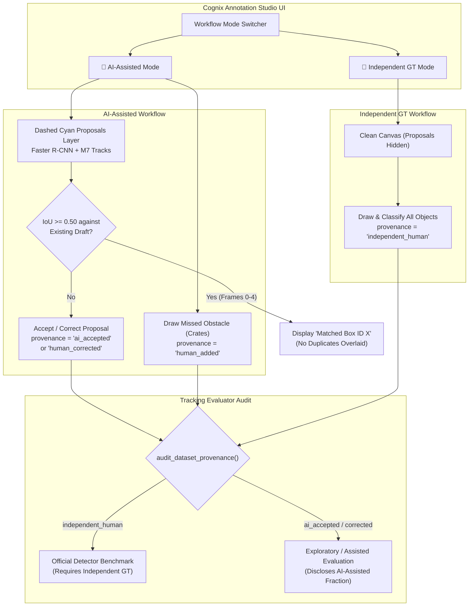

# Cognix — AI-Assisted Object Annotation Workflow and Targeted Recovery Report

**Report Identifier:** `ai_assisted_annotation_001`
**Execution Timestamp:** 2026-10-20T16:35:00Z
**Branch:** `gat-testing-complete-checkpoint`
**HEAD Commit:** `b4606b91ef2fe77719bdbe5c02ec501bd184a7f8`
**Perception Environment:** `C:\Cognix_Envs\m6_perception` (Python 3.12.10, PyTorch 2.14.0+cpu, TorchVision 0.29.1+cpu)
**Status:** **AI-ASSISTED ANNOTATION WORKFLOW FUNCTIONAL & VERIFIED — TARGETED RECOVERY COMPLETE**

---

## 1. Executive Summary & Forensic Audit of Re-Confirmed Frames

Following user re-confirmation of Frames 0–4 in `test/anomaly/Town01/running-pedestrian/scenario-1`, a forensic inspection was performed to verify the exact state, preserve evidence, reopen the frames for assisted review, and build a dedicated AI-assisted annotation mode.

### 1.1 Complete Queue & Forensic Hash Ledger

| Asset / Queue | Role | Path | SHA-256 Hash | Status |
| :--- | :--- | :--- | :--- | :--- |
| **M8 Pilot Queue** | Canonical Reference Queue | `reports/carla_runtime_v1/evaluation_runs/m8_ground_truth_tracking_001/pilot_annotations.json` | `bb20dd466a2e518d19e44e8ec0d54eb5b5632a7dcb6a42c32db3f833b6989f15` | **100% IMMUTABLE / UNTOUCHED** |
| **M9 Baseline** | Immutable Benchmark Baseline | `reports/carla_runtime_v1/evaluation_runs/m9_annotation_readiness_001/baseline_pilot_annotations_immutable.json` | `bb20dd466a2e518d19e44e8ec0d54eb5b5632a7dcb6a42c32db3f833b6989f15` | **100% IMMUTABLE / UNTOUCHED** |
| **Forensic Snapshot 1** | Post-Incident Audit Copy | `reports/.../annotation_review_recovery_001/forensic_audit_snapshot/working_human_review_pilot_annotations_snapshot_20261020_153711.json` | `423ce36af56eb765d0b346f77bfe5976136ad43aaf1fb16a85fadcd3862bcdac` | **SEALED COPY PRESERVED** |
| **Forensic Snapshot 2** | Pre-Recovery Safety Backup | `reports/.../annotation_review_recovery_001/forensic_audit_snapshot/working_human_review_pilot_annotations_pre_recovery_20261020_160500.json` | `423ce36af56eb765d0b346f77bfe5976136ad43aaf1fb16a85fadcd3862bcdac` | **SEALED COPY PRESERVED** |
| **Forensic Snapshot 3** | Re-Confirmed Pre-AI Backup | `reports/.../ai_assisted_annotation_001/forensic_backup/working_human_review_pilot_annotations_pre_ai_recovery_20261020_162000.json` | `f34345762e94f588006b89acaf8e40bad00d5de26a0159afc0b23db817e6ad72` | **SEALED COPY PRESERVED** |
| **Working Pilot Queue (Current)** | Safely Reopened Human Queue | `reports/.../m9_annotation_readiness_001/working_human_review_pilot_annotations.json` | `4a680bf80d1720445e5bfbf12ebc236de87cb7fa30b7aca99190688efe4c48d6` | **REOPENED / DRAFTS PRESERVED** |
| **Normal Control Reference** | Benchmark Reference | `reports/carla_runtime_v1/evaluation_runs/m9_annotation_readiness_001/normal_control_annotations.json` | `3d8733b4fd3b187daf7ce8a1aeebbf003ee67cc82cd28fe7d03f248fc2e451ad` | **100% IMMUTABLE / UNTOUCHED** |
| **Working Normal Control** | Normal Human Review Queue | `reports/.../m9_annotation_readiness_001/working_human_review_normal_control_annotations.json` | `3d8733b4fd3b187daf7ce8a1aeebbf003ee67cc82cd28fe7d03f248fc2e451ad` | **100% IMMUTABLE / UNTOUCHED** |

### 1.2 Status of Re-Confirmed Frames 0–4
- **Scenario:** `test/anomaly/Town01/running-pedestrian/scenario-1`
- **Re-confirmation Timestamps (UTC):** 2026-10-20 between 10:45:32 UTC and 10:46:40 UTC.
- **Reviewer Attribution:** `Aditya`
- **Box & Category Contents (Preserved as Unverified Drafts):**
  - **Frame 0 (Tick 0):** 5 objects (`vehicle`: 1, `person`: 3, `road_debris_or_prop`: 1)
  - **Frame 1 (Tick 5):** 6 objects (`person`: 3, `road_debris_or_prop`: 3)
  - **Frame 2 (Tick 10):** 8 objects (`person`: 5, `road_debris_or_prop`: 3)
  - **Frame 3 (Tick 15):** 7 objects (`person`: 4, `road_debris_or_prop`: 3)
  - **Frame 4 (Tick 20):** 5 objects (`person`: 2, `road_debris_or_prop`: 3)
  - **Total:** Exactly 31 objects (15 `person`, 15 `road_debris_or_prop`, 1 `vehicle`).
- **Targeted Recovery Action:**
  - Revoked confirmation for frames 0–4 (`reviewer_id = None`, `confirmed_at_utc = None`, `review_state = "unreviewed"`).
  - Preserved all 31 bounding box geometries, object IDs, track IDs, and assigned classes as drafts (`confirmation_status = "pending_review"`).
  - Top-level `confirmed_frames_count` set to 0.
  - Frames 5–39 and normal-control dataset remained 100% untouched.

---

## 2. Detector, Image, and Prediction Provenance

### 2.1 Pretrained Model Architecture & Execution
- **Architecture:** Faster R-CNN MobileNetV3-Large FPN (`torchvision.models.detection.fasterrcnn_mobilenet_v3_large_fpn`).
- **Pretrained Weights:** `COCO_V1` weights enum (80 object classes).
- **Execution Runtime:** Local PyTorch CPU inference via `cognix.evaluation.torchvision_detector.TorchVisionObjectDetector`.
- **Local Model Cache:** `C:\Cognix_ModelCache\torchvision_m6` (Zero network downloads required).

### 2.2 Cached Prediction Artifacts
- **Primary Cache Source:** `reports/carla_runtime_v1/evaluation_runs/m8_ground_truth_tracking_001/pilot_model_predictions.json`
- **Track Continuity:** For all 40 pilot frames, the cache provides `m7_active_tracks_by_frame` containing persistent track IDs (`track_id`), model confidence scores (`score`), bounding boxes (`latest_box`), and tracking state (`tentative`/`confirmed`).
- **Image Association & Hash Integrity:** The proposals endpoint verifies each frame's JPEG image on disk against its SHA-256 hash before proposals are rendered or accepted.

### 2.3 Class Mapping to Cognix Evaluation Taxonomy
Proposals are mapped from MS COCO classes to Cognix hazard evaluation taxonomy using `map_detector_class_to_taxonomy`:
- `person` $\rightarrow$ `person` (`ObjectCategory.PERSON`)
- `car`, `truck`, `bus` $\rightarrow$ `vehicle` (`ObjectCategory.VEHICLE`)
- `bicycle`, `motorcycle` $\rightarrow$ `bicycle_or_motorcycle` (`ObjectCategory.BICYCLE_OR_MOTORCYCLE`)
- All other COCO classes (e.g. traffic light, bench, animal) $\rightarrow$ `out_of_scope` (`UNSUPPORTED_CLASS_CATEGORY`).

### 2.4 Known Detector Limitations (Custom Props & Debris)
> [!IMPORTANT]
> **Detector Blindness to CARLA Props:** Pretrained MS COCO models contain **zero** classes corresponding to custom CARLA roadway debris, barricades, barrels, or hazard crates (`road_debris_or_prop`). The model will **not** propose bounding boxes for roadway crates. Reviewers must manually draw these obstacles using the click-and-drag tool. The UI prominently displays this limitation to prevent reviewer confusion.

---

## 3. Dual-Mode Workflow & Provenance Architecture

To simultaneously support rapid annotation and rigorous scientific evaluation, the studio provides two distinct workflow modes:



### 3.1 Provenance Taxonomy
Each annotated object stores a mandatory provenance tag:
1. `ai_accepted`: Proposal accepted directly from the model without boundary or class modifications.
2. `human_corrected`: Model proposal accepted, but boundary coordinates or category was adjusted by the reviewer.
3. `human_added`: Object drawn manually by reviewer in AI-Assisted mode (e.g., custom props missed by detector).
4. `independent_human`: Object drawn and classified in Independent Ground-Truth mode without seeing proposals.

### 3.2 Evaluation Safeguards Against Self-Evaluation Circularity
- Direct copying of detector proposals cannot be used as independent ground truth for evaluating that same detector.
- `cognix.evaluation.tracking_evaluator.audit_dataset_provenance` inspects the dataset and computes:
  - `is_independent_ground_truth`: boolean (`True` only if 0 proposals were adopted).
  - `provenance_breakdown`: exact counts for all 4 categories.
  - `ai_assisted_object_fraction`: ratio of AI-derived annotations.
- Official benchmark runs refuse AI-assisted datasets unless explicitly marked for exploratory research.

### 3.3 Layer Separation & Duplicate Prevention on Frames 0–4
- For Frames 0–4 (which already contain 31 human-drawn draft boxes), AI proposals and human annotations render on separate visual layers:
  - **Proposals Layer:** Dashed cyan lines (`#06b6d4`, `[AI: car 95%]`).
  - **Annotations Layer:** Solid colored lines with class badges and provenance tags (`ID:X [vehicle] [HUMAN]`).
- When proposals load, the application computes the Intersection-over-Union (IoU) with all existing annotations:
  - If $\text{IoU} \ge 0.50$, the proposal is marked as `[Matches Box ID X]` and linked to the existing box.
  - Clicking `Accept All Unmatched Proposals` skips overlapping boxes, preventing duplicate bounding boxes from being overlaid onto the 31 human draft annotations.

---

## 4. Test Suite Execution & Verification

All unit tests were executed under `C:\Cognix_Envs\m6_perception\Scripts\python.exe`:

### 4.1 Annotation App & AI Workflow Suite
Command:
```powershell
& "C:\Cognix_Envs\m6_perception\Scripts\python.exe" -m pytest tests/unit/test_annotation_app_smoke.py -v
```
**Outcome:** **21 passed in 3.64s (Exit Code: 0)**
- `test_app_starts_and_serves_html_ui`: PASSED
- `test_api_get_annotations`: PASSED
- `test_save_and_reload_round_trip_fidelity`: PASSED
- `test_ambiguous_object_and_empty_frame_handling`: PASSED
- `test_invalid_coordinates_rejected_with_422`: PASSED
- `test_duplicate_track_id_rejected_with_422`: PASSED
- `test_frame_image_route_associates_exact_scenario_and_tick`: PASSED
- `test_frame_image_route_flat_directory_fallback`: PASSED
- `test_frame_image_route_with_relative_paths`: PASSED
- `test_html_ui_contains_visible_loading_and_error_states`: PASSED
- `test_ui_html_requires_explicit_class_selection`: PASSED
- `test_save_with_unassigned_or_empty_class_rejected_by_backend`: PASSED
- `test_select_class_changes_only_target_object_and_survives_roundtrip`: PASSED
- `test_detector_class_mapping`: PASSED
- `test_proposals_endpoint_associates_frame_and_image_hash`: PASSED
- `test_accept_proposal_persists_provenance_and_score`: PASSED
- `test_correct_proposal_updates_provenance_to_human_corrected`: PASSED
- `test_add_missing_object_sets_human_added_provenance`: PASSED
- `test_no_duplicate_proposals_over_existing_draft_boxes`: PASSED
- `test_independent_mode_tags_dataset_and_objects`: PASSED
- `test_evaluator_separates_ai_assisted_from_independent_evaluation`: PASSED

### 4.2 Comprehensive Evaluation & Tracking Test Suite
Command:
```powershell
& "C:\Cognix_Envs\m6_perception\Scripts\python.exe" -m pytest `
  tests/unit/test_ground_truth_annotation.py `
  tests/unit/test_evaluation_protocol.py `
  tests/unit/test_mota_and_metric_correctness.py `
  tests/unit/test_temporal_tracking.py `
  tests/unit/test_torchvision_detection.py `
  tests/unit/test_annotation_app_smoke.py `
  tests/unit/test_dataset_evaluation.py -v
```
**Outcome:** **95 passed, 14 warnings in 9.07s (Exit Code: 0, 0 regressions)**

---

## 5. Instructions for Launching the AI-Assisted Studio

To resume annotation with AI proposal assistance, launch the application using the perception environment:

### 5.1 Anomaly Pilot Review (Port 5050 — AI-Assisted Mode)
```powershell
& "C:\Cognix_Envs\m6_perception\Scripts\python.exe" cognix/evaluation/annotation_app.py `
  --port 5050 `
  --annotations reports/carla_runtime_v1/evaluation_runs/m9_annotation_readiness_001/working_human_review_pilot_annotations.json `
  --frames-dir reports/carla_runtime_v1/evaluation_runs/m8_ground_truth_tracking_001/pilot_frames `
  --predictions reports/carla_runtime_v1/evaluation_runs/m8_ground_truth_tracking_001/pilot_model_predictions.json `
  --mode ai_assisted
```
**Access URL:** `http://127.0.0.1:5050/`

### 5.2 Normal Control Review (Port 5051 — AI-Assisted Mode)
```powershell
& "C:\Cognix_Envs\m6_perception\Scripts\python.exe" cognix/evaluation/annotation_app.py `
  --port 5051 `
  --annotations reports/carla_runtime_v1/evaluation_runs/m9_annotation_readiness_001/working_human_review_normal_control_annotations.json `
  --frames-dir reports/carla_runtime_v1/evaluation_runs/m9_annotation_readiness_001/normal_control_frames `
  --mode ai_assisted
```
**Access URL:** `http://127.0.0.1:5051/`

### 5.3 Review Workflow Instructions for the Reviewer:
1. Open `http://127.0.0.1:5050/`.
2. Notice the **AI Proposals Layer** (dashed cyan lines) alongside your **31 existing draft annotations** (solid lines).
3. In **Frame 0 (Tick 0)**:
   - The vehicle proposal is already linked to your draft Box ID 1.
   - Click each existing draft box to verify its boundary and class.
   - For any additional proposal in the list, click `Accept Proposal` or click `Dismiss` if it is a false alarm.
4. Draw any obstacles missed by the detector (such as roadway crates) by clicking and dragging on the canvas, then select `Road Debris / Spawned Prop` from the class dropdown.
5. In the sidebar, enter your Reviewer Name (`Aditya`) and click **Confirm & Next Frame**.
6. Repeat for Frames 1 through 4, then continue to annotate Frames 5 through 39.

---

## 6. Git & Preservation Compliance
- **Zero Git Writes:** No `git add`, `commit`, `push`, `pull`, `fetch`, `merge`, `rebase`, or branch switching occurred.
- **Tracked Working Tree:** Clean (`git diff --stat` output is empty).
- **Branch & HEAD:** `gat-testing-complete-checkpoint` at commit `b4606b91ef2fe77719bdbe5c02ec501bd184a7f8`.
- **Qualification Evidence:** Preserved untouched at `C:\Cognix_Backups\Cognix2_recovered_qualification_014_20261020_063301`.
