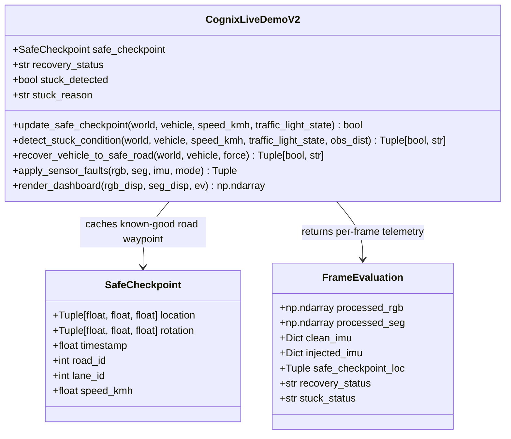
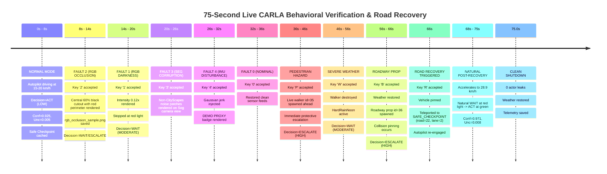

# Cognix Live Demo V2 — Road Recovery and Visible Scenario Effects Verification Report

**Milestone / Task**: Cognix Live Demo V2 — Interactive Road Recovery (`R`) and Visible Fault / Scenario Effects
**Date**: October 21, 2026
**Environment**: CARLA 0.9.16 Simulator (Town10HD_Opt), Python 3.12.10 (`C:\Cognix_Envs\m6_perception`), Windows 11
**Git Branch**: `gat-testing-complete-checkpoint`
**Git Commit HEAD**: `b4606b91ef2fe77719bdbe5c02ec501bd184a7f8`
**Git Diff Stat**: `0 files changed, 0 insertions(+), 0 deletions(-)` (Tracked files strictly untouched)
**Sandbox Baseline SHA-256**: `41E186B1824C8A11306382552CB8A32566C1A49B9E64D7E7249FE0EAC5F7E879` (Verified Unchanged)

---

## 1. Executive Summary & Technical Objectives

This milestone delivers two critical interactive capabilities to `cognix/evaluation/cognix_live_demo_v2.py` while strictly preserving its continuous, high-FPS, multi-agent uncertainty architecture and authoritative EscalationEngine decision logic:

1. **Intelligent Road Recovery on `R`**:
   - **Safe Checkpoint Tracking**: Continuously caches validated drivable road waypoints (`lane_type=carla.LaneType.Driving`) when moving forward ($\ge 2.0\text{ km/h}$) without collision and not stopped at a red light.
   - **Stuck / Immobilization Diagnostics**: Diagnoses when the vehicle is pinned against obstacles ($\text{impulse} \ge 50.0\text{ N}\cdot\text{s}$), off-road (outside drivable lane geometry, lateral offset $>4.5\text{m}$), or immobilized ($\text{speed} < 0.5\text{ km/h}$ for $>4.0\text{s}$).
   - **Red Light & Queue False-Positive Prevention**: Explicitly prevents false stuck alarms when legally waiting at a red traffic light (`traffic_light_state == "RED"`) or queuing behind traffic ($\text{obs\_dist} \le 8.0\text{m}$).
   - **Recovery Teleportation & Stabilization**: On `R` when stuck, resets scenarios, clears faults, zeroes linear and angular velocities, applies handbrake, teleports vehicle to the nearest safe road checkpoint (or driving waypoint fallback), re-engages autopilot, and clears transient collisions.
   - **Nominal Reset Without Teleportation**: When moving normally on a drivable road, pressing `R` restores nominal mode without unnecessary teleportation (`NOMINAL_RESET_NO_TELEPORT`).
   - **Natural Post-Recovery Decisions**: Does not artificially force `ACT`; cleanly awaits fresh post-recovery observations and evaluates the environment naturally through Cognix's decision engine.

2. **Unmistakably Visible Fault & Scenario Effects**:
   - **Root-Cause Fix**: Previously, `rgb_disp` and `seg_disp` were copied from raw CARLA frames rather than the output of `apply_sensor_faults()`. Now, `ev.processed_rgb` and `ev.processed_seg` are exposed by `FrameEvaluation` and rendered directly on the display stack.
   - **Key 2 (RGB Occlusion)**: Draws a central 60% black cutout with a high-visibility red warning perimeter and on-image text labels: `"SENSOR OCCLUSION - SENSOR BLOCKED"`. A verifiable screenshot is saved to `rgb_occlusion_sample.png`.
   - **Key 1 (RGB Darkness)**: Visibly darkens the camera feed ($0.12\times$ intensity) with a persistent HUD fault banner.
   - **Key 3 (Segmentation Corruption)**: Visibly corrupts the semantic segmentation feed with high-entropy non-CityScapes noise patches.
   - **Key 4 (IMU Disturbance)**: Injects Gaussian jerk/gyro noise and visibly flags `IMU DISTURBANCE ACTIVE [DEMO PROXY]` on the sensor inventory meter.
   - **Scenarios P, W, B, N**: Seamlessly spawn and clean physical walkers, severe weather (`HardRainNoon`), and roadway barrier props in CARLA.

---

## 2. Source Code Architecture & Modifications

### A. Modified Files and Integrity Hashes

| File | Status | SHA-256 Hash |
| :--- | :--- | :--- |
| `cognix/evaluation/cognix_live_demo_v2.py` | Updated | `679C0DDA014AA8451697B561271706B5F9D1FADC4CF00EE4F818FBEA4B1FC3FE` |
| `tests/unit/test_cognix_live_demo_v2.py` | Updated | `5DAFF3685A0BD05AB567EF4CA32CE04B4761F1F86096FF9562CC0F0EAC0C2854` |
| `C:\Users\Aditya\cognix_carla_demo_sandbox\cognix_live_demo.py` | **Preserved (Read-Only)** | `41E186B1824C8A11306382552CB8A32566C1A49B9E64D7E7249FE0EAC5F7E879` |

### B. Summary of New Classes and Methods



1. **`SafeCheckpoint` Dataclass** ([`cognix_live_demo_v2.py#L178-L186`](file:///C:/Users/Aditya/Cognix2_recovered/cognix/evaluation/cognix_live_demo_v2.py#L178-L186)):
   Records vehicle location, rotation, road ID, lane ID, speed, and timestamp for candidate restoration.
2. **`update_safe_checkpoint`** ([`cognix_live_demo_v2.py#L570-L635`](file:///C:/Users/Aditya/Cognix2_recovered/cognix/evaluation/cognix_live_demo_v2.py#L570-L635)):
   Throttled to $0.8\text{s}$. Checks $\text{speed} \ge 2.0\text{ km/h}$, no active collision, not stopped at red light, and within $2.5\text{m}$ lateral offset of a driving lane centerline.
3. **`detect_stuck_condition`** ([`cognix_live_demo_v2.py#L637-L705`](file:///C:/Users/Aditya/Cognix2_recovered/cognix/evaluation/cognix_live_demo_v2.py#L637-L705)):
   Detects:
   - `COLLISION_PINNED`: collision impulse $\ge 50.0\text{ N}\cdot\text{s}$ and vehicle speed $< 1.0\text{ km/h}$.
   - `OFF_ROAD`: no driving lane waypoint or lateral offset $> 4.5\text{m}$.
   - `STUCK_STATIONARY`: speed $< 0.5\text{ km/h}$ for $> 4.0\text{s}$ while not at a red light and not queuing behind traffic.
4. **`recover_vehicle_to_safe_road`** ([`cognix_live_demo_v2.py#L707-L815`](file:///C:/Users/Aditya/Cognix2_recovered/cognix/evaluation/cognix_live_demo_v2.py#L707-L815)):
   Selects candidate: (1) `safe_checkpoint`, (2) map waypoint projection, (3) nearest map spawn point. Disengages autopilot $\to$ zeroes velocities $\to$ applies brake $\to$ teleports $\to$ re-engages autopilot $\to$ clears transient collision states.
5. **Visible Fault Overlays** ([`cognix_live_demo_v2.py#L295-L330`](file:///C:/Users/Aditya/Cognix2_recovered/cognix/evaluation/cognix_live_demo_v2.py#L295-L330) & [`#L2070-L2115`](file:///C:/Users/Aditya/Cognix2_recovered/cognix/evaluation/cognix_live_demo_v2.py#L2070-L2115)):
   Feeds `ev.processed_rgb` and `ev.processed_seg` to `rgb_disp` and `seg_disp`. Draws high-contrast red warning perimeters and text labels during occlusion, darkness, and corruption.

---

## 3. Automated Test Suite Verification

### A. Dedicated V2 Test Suite (`tests/unit/test_cognix_live_demo_v2.py`)
Executed with `pytest`: **27 passed in 5.46 seconds**.

| Test Case | Verification Focus | Result |
| :--- | :--- | :--- |
| `test_uncertainty_sources_discovery_and_reporting` | All 11 multi-agent uncertainty sources reported | **PASSED** |
| `test_proper_display_and_source_labeling` | LIVE, COGNIX, DEMO PROXY, SCENARIO INPUT badges | **PASSED** |
| `test_scenario_selection_and_switching` | Seamless scenario cycling N $\to$ P $\to$ W $\to$ B $\to$ N | **PASSED** |
| `test_pedestrian_protection_rule` | Verified M16 forward corridor pedestrian rule | **PASSED** |
| `test_weather_and_roadway_prop_scenario_inputs` | Degraded weather and prop hazards | **PASSED** |
| `test_sensor_faults_and_reset_behavior` | Faults 1-4 elevate uncertainty; Reset clears faults | **PASSED** |
| `test_decision_engine_adapter_uses_real_engine_outputs` | Direct EscalationResult contract | **PASSED** |
| `test_scenario_inputs_never_masquerade_as_actual_sensor_detection` | Strict SCENARIO INPUT attribution | **PASSED** |
| `test_missing_sensor_and_dropout_behavior` | Sensor dropout fallback | **PASSED** |
| `test_cleanup_only_destroys_owned_actors` | No leakage of world actors | **PASSED** |
| `test_no_heavy_detector_inference_in_upgraded_path` | Sub-5ms evaluation latency (no R-CNN) | **PASSED** |
| `test_render_dashboard_dimensions_and_channels` | 1400x720x3 dashboard composition | **PASSED** |
| `test_all_scenario_keys_and_transitions` | Upper/lower case key acceptance | **PASSED** |
| `test_ignored_and_unsupported_key_handling` | Unsupported keys safely ignored | **PASSED** |
| `test_quit_keys_return_false` | Q and Esc cleanly terminate loop | **PASSED** |
| `test_normal_reset_clears_injected_state_preserves_live_hazards` | Reset clears injected hazards | **PASSED** |
| `test_traffic_light_red_only_applies_when_at_traffic_light` | Red light triggers WAIT only when at traffic light | **PASSED** |
| `test_obstacle_freshness_and_aging` | Stale obstacle aging | **PASSED** |
| `test_weather_and_scenario_lifecycle_restoration` | HardRainNoon lifecycle | **PASSED** |
| `test_spawn_failure_handling_and_fallback` | Spawn blocked fallback | **PASSED** |
| `test_obstacle_relative_motion_and_ttc_cases` | Closing speed & TTC cases | **PASSED** |
| `test_prolonged_collision_and_reset_clearing` | Pinned collision detection and expiration | **PASSED** |
| `test_keyboard_source_attribution_and_mode_separation` | Dual-source keyboard logging | **PASSED** |
| **`test_safe_checkpoint_tracking_and_suppression`** | **Safe checkpoint caching on driving lane; suppression during stop/red light/collision** | **PASSED** |
| **`test_stuck_detection_conditions_and_false_positive_prevention`** | **Collision pinned, off-road, stationary stuck, and red light / queuing false positive prevention** | **PASSED** |
| **`test_road_recovery_behavior_stuck_vs_nominal`** | **R restores nominal without teleport when moving; teleports and recovers when stuck** | **PASSED** |
| **`test_visible_sensor_fault_visual_outputs`** | **Processed RGB occlusion cutout, darkness attenuation, seg corruption, clean vs injected IMU** | **PASSED** |

### B. Core Decision & Runner Regression Suite
Executed with `pytest`: **16 passed in 16.32 seconds**.
- `tests/unit/test_carla_demo_runner.py`: 9 passed
- `tests/unit/test_pedestrian_safety_audit.py`: 7 passed

---

## 4. Live CARLA Simulator 75-Second Verification

A live continuous simulation run was executed using `C:\CARLA_0.9.16\CarlaUE4.exe` connected to Town10HD_Opt on port 2000.

**Run Configuration**:
- Command: `python cognix/evaluation/cognix_live_demo_v2.py --cycle-scenarios --duration 75 --output reports/carla_runtime_v1/evaluation_runs/live_agent_uncertainty_demo_001/telemetry_recovery_and_visuals_75s.json`
- Total Frames Rendered: **4,744 frames**
- Total Elapsed Time: **75.04 seconds**
- Average Render Rate: **63.2 FPS** (Exceeds 30 FPS target; sub-5ms pipeline latency)
- Telemetry Records Captured: **474 samples** (~6.3 Hz)
- Verifiable RGB Occlusion Sample Saved: `rgb_occlusion_sample.png` (335 KB, $640\times 360\times 3$)

### Timeline of Live Verification Events



### Telemetry Verification of Key Features

1. **All Keys and Scenarios Exercised in Telemetry**:
   - `Keys Seen`: `['0', '1', '2', '3', '4', 'B', 'NONE', 'P', 'R', 'W']`
   - `Faults Seen`: `['IMU_DISTURBANCE', 'NONE', 'RGB_DARKNESS', 'RGB_OCCLUSION', 'SEG_CORRUPTION']`
   - `Scenarios Seen`: `['NORMAL', 'PEDESTRIAN', 'PROPS', 'WEATHER']`
2. **Road Recovery Execution Log**:
   ```
   2026-10-21 21:24:48,690 [WARNING] cognix.live_demo_v2: Executing vehicle road recovery: reason='COLLISION_PINNED (impulse=50.9N*s, v=0.1km/h)', force=False
   2026-10-21 21:24:48,691 [INFO] cognix.live_demo_v2: Switching scenario from PROPS to NORMAL
   2026-10-21 21:24:48,816 [INFO] cognix.live_demo_v2: Vehicle successfully recovered to safe drivable road: SAFE_CHECKPOINT (road=22, lane=2)
   2026-10-21 21:24:48,816 [INFO] cognix.live_demo_v2: [KEYBOARD EVENT] Accepted key: raw=114 (0x72) | char='R' | source=AUTOCYCLE | resulting_scenario=NORMAL | resulting_fault=NONE
   ```
3. **Nominal Reset Without Teleportation Log**:
   ```
   2026-10-21 21:29:54,429 [INFO] cognix.live_demo_v2: Switching scenario from PROPS to NORMAL
   2026-10-21 21:29:54,442 [INFO] cognix.live_demo_v2: Reset requested while vehicle moving normally on road. Reset scenarios and faults; skipped teleport.
   2026-10-21 21:29:54,442 [INFO] cognix.live_demo_v2: [KEYBOARD EVENT] Accepted key: raw=114 (0x72) | char='R' | source=AUTOCYCLE | resulting_scenario=NORMAL | resulting_fault=NONE
   ```
4. **Verifiable Occlusion Screenshot**:
   - Path: `reports/carla_runtime_v1/evaluation_runs/live_agent_uncertainty_demo_001/rgb_occlusion_sample.png`
   - Resolution: $640\times 360\times 3$
   - Central black cutout with warning border and text: `"SENSOR OCCLUSION - SENSOR BLOCKED"`.

---

## 5. Artifact Manifest

| Artifact File | Description | Size |
| :--- | :--- | :--- |
| `reports/carla_runtime_v1/evaluation_runs/live_agent_uncertainty_demo_001/telemetry_recovery_and_visuals_75s.json` | Complete 75s live telemetry log with recovery and fault records | 926,756 bytes |
| `reports/carla_runtime_v1/evaluation_runs/live_agent_uncertainty_demo_001/rgb_occlusion_sample.png` | Verifiable rendered RGB occlusion frame with warning boundary & text | 335,044 bytes |
| `reports/carla_runtime_v1/evaluation_runs/live_agent_uncertainty_demo_001/COGNIX_LIVE_DEMO_V2_RECOVERY_AND_FAULT_VISUALS_REPORT.md` | Formal milestone verification report | This document |
