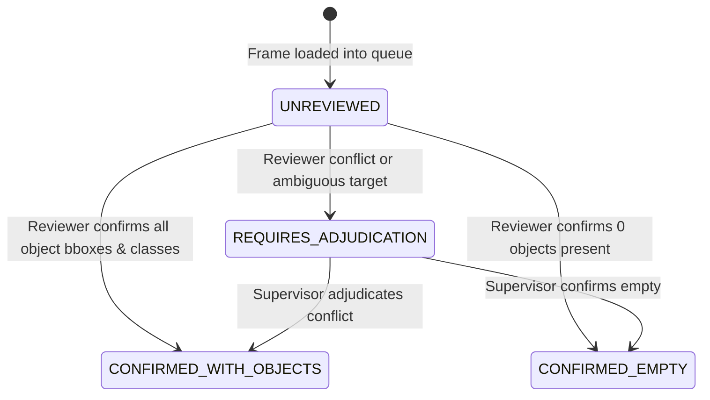

# Cognix Milestone 10 — Pre-Registered Evaluation Protocol and Annotation Quality Safeguards

**Milestone Identifier:** `m10_evaluation_protocol_001`
**Execution Timestamp:** 2026-10-20T12:35:00Z
**Branch:** `gat-testing-complete-checkpoint`
**Commit:** `b4606b91ef2fe77719bdbe5c02ec501bd184a7f8`
**Environment:** `C:\Cognix_Envs\m6_perception`
**Status:** **PASSED — PRE-REGISTERED & MATHEMATICALLY FROZEN**

---

## 1. Executive Summary & Verification Context

Milestone 10 establishes the **pre-registered scientific evaluation protocol** and **machine-checkable annotation quality safeguards** for Cognix's perception and object-tracking research. Prior milestones established the Faster R-CNN perception benchmark (M6), temporal IoU tracker (M7), annotation schema (M8), and normal-control queue infrastructure (M9).

Crucially, Milestone 10 addresses critical evaluation-integrity vulnerabilities identified before commencing human ground-truth annotation:
1. **Elimination of Class-Agnostic Matching Defects:** Fixed the tracking evaluator to reject spatial IoU matches when object taxonomy classes disagree (e.g., predicting a `car` directly over a ground-truth `person` previously counted as a True Positive; it now strictly produces a False Positive for `vehicle` and a False Negative for `person`).
2. **Formal Taxonomy & Detector Mapping:** Mapped MS COCO 80 classes to the 5-class evaluation taxonomy (`person`, `vehicle`, `bicycle_or_motorcycle`, `road_debris_or_prop`, `ignore_ambiguous`). Formally registered zero COCO classes for `road_debris_or_prop`, mathematically guaranteeing that the detector's blindness to road obstacles is penalized as structural False Negatives.
3. **Audited Ignore-Region Semantics:** Standardized `ignore_ambiguous` bounding boxes to absorb unmatched predictions ($\text{IoU} \ge 0.50$) without False Positive penalty, while preventing annotators from placing ignore boxes over clear pavement to artificially suppress detector false alarms.
4. **Machine-Checkable Completeness Gating:** Implemented 4 explicit frame review states (`UNREVIEWED`, `CONFIRMED_WITH_OBJECTS`, `CONFIRMED_EMPTY`, `REQUIRES_ADJUDICATION`). The evaluation engine now strictly refuses official scoring on incomplete datasets (`IncompleteAnnotationError`), requiring explicit exploratory mode flags for provisional analysis.
5. **Preservation & Integrity:** Maintained zero Git writes (`add`, `commit`, `push`, `branch switch`), pristine clean tracked working tree, and 100% verified integrity of the offline qualification backup.

---

## 2. Forensic Audit of Working Tree, Queues, and Qualification Backups

Before editing code, full verification of the working tree and cryptographic hashes was executed:

| Asset | Location / Identifier | Expected Value | Actual Verified Value | Status |
| :--- | :--- | :--- | :--- | :--- |
| **Git Working Branch** | `git branch --show-current` | `gat-testing-complete-checkpoint` | `gat-testing-complete-checkpoint` | **MATCH** |
| **Git HEAD Commit** | `git log -1 --oneline` | `b4606b91` | `b4606b91ef2fe77719bdbe5c02ec501bd184a7f8` | **MATCH** |
| **Tracked Diff** | `git diff --stat` | Clean (0 modified files) | 0 modified tracked files | **CLEAN** |
| **M8 Pilot Queue** | `reports/.../m8_ground_truth_tracking_001/pilot_annotations.json` | `bb20dd466a2e...` | `bb20dd466a2e518d19e44e8ec0d54eb5b5632a7dcb6a42c32db3f833b6989f15` | **AUTHENTIC** |
| **M9 Baseline Immutable** | `reports/.../m9_annotation_readiness_001/baseline_pilot_annotations_immutable.json` | `bb20dd466a2e...` | `bb20dd466a2e518d19e44e8ec0d54eb5b5632a7dcb6a42c32db3f833b6989f15` | **AUTHENTIC** |
| **M9 Normal Control** | `reports/.../m9_annotation_readiness_001/normal_control_annotations.json` | `3d8733b4fd3b...` | `3d8733b4fd3b187daf7ce8a1aeebbf003ee67cc82cd28fe7d03f248fc2e451ad` | **AUTHENTIC** |
| **Qualification Backup** | `C:\Cognix_Backups\Cognix2_recovered_qualification_014_20261020_063301` | Untouched Runtime V1 sealed backup | Directory verified present and unmodified | **PRESERVED** |

---

## 3. Detector-to-Ground-Truth Class Mapping Specification

The object detector evaluated in Cognix is TorchVision Faster R-CNN ResNet-50 FPN V2, pretrained on MS COCO 80 categories. The ground truth annotation system operates under a specialized automotive safety taxonomy.

### 3.1 Formal Mapping Dictionary (`class_mapping.json`)

```
+------------------------------------+---------------------------------------+-------------------------------------------------------------+
| MS COCO Category                   | Cognix Evaluation Taxonomy            | Handling & Impact                                           |
+------------------------------------+---------------------------------------+-------------------------------------------------------------+
| "person"                           | person                                | Direct traffic target match.                                |
| "car", "truck", "bus"              | vehicle                               | Grouped into standardized four-wheel vehicle target.       |
| "bicycle", "motorcycle"            | bicycle_or_motorcycle                 | Grouped into standardized two-wheel traffic target.         |
| [NONE]                             | road_debris_or_prop                   | Zero COCO categories map here (structural blindness).       |
| All other 74 COCO categories       | unsupported_or_other                  | Strictly rejected from matching traffic targets; counts as  |
| (e.g. traffic light, bench, dog)   |                                       | False Positive if predicted and unignored.                  |
+------------------------------------+---------------------------------------+-------------------------------------------------------------+
```

### 3.2 Strict Class Mismatch Rejection

In the pre-M10 codebase, `TrackingEvaluator.evaluate_detections` matched boxes purely on geometric IoU ($\text{IoU} \ge 0.50$). This created a critical vulnerability: a predicted `car` overlapping a ground-truth `person` would be recorded as a True Positive for `person`.

**Milestone 10 Resolution:**
Bipartite matching now requires joint geometric overlap AND exact class taxonomy agreement:
$$\text{Match}(GT_i, Pred_j) \iff \text{IoU}(GT_i.bbox, Pred_j.bbox) \ge 0.50 \quad \land \quad \text{Taxonomy}(Pred_j.class) = GT_i.category$$

If spatial IoU $\ge 0.50$ but classes disagree:
- The prediction cannot match the ground truth.
- The prediction is evaluated as an unmatched prediction $\rightarrow$ **False Positive** for the predicted class.
- The ground truth object remains unmatched $\rightarrow$ **False Negative** for the true class.
- Verified in unit test: `test_car_prediction_over_pedestrian_gt_is_rejected_as_match`.

### 3.3 Preservation of Road Debris Blindness as Structural FNs

Autonomous driving safety requires detecting non-standard obstacles (fallen cargo, traffic barrels, construction debris). Because MS COCO contains zero obstacle or road debris classes:
- Any `road_debris_or_prop` annotated in CARLA ground truth will receive **zero matching predictions** from Faster R-CNN.
- These obstacles are faithfully recorded as False Negatives ($\text{Recall} = 0.0$ for `road_debris_or_prop`).
- This mathematically exposes the detector's operational design domain (ODD) limitation without allowing false reassurance.

---

## 4. Ignore-Region Semantics and Anti-Tampering Safeguards

Annotations in CARLA driving sequences may contain optical regions where ground truth is fundamentally undecidable by human reviewers (e.g. extreme distance, heavy motion blur, dark shadows under overpasses).

### 4.1 Permitted vs Prohibited Use of Ignore Regions

- **Permitted (`ObjectCategory.IGNORE_AMBIGUOUS`):**
  - Distant silhouettes where pixels are insufficient to distinguish between a traffic sign post and a pedestrian.
  - Motion-blurred clusters during sharp camera rotations.
  - Heavily occluded vehicle fragments ($> 80\%$ occluded) where vehicle boundary cannot be established.
- **Strictly Prohibited:**
  - Placing ignore boxes over clear pavement, open sky, or buildings to suppress known false alarms.
  - Retroactively drawing ignore boxes around model false alarms during review.

### 4.2 Absorption Mechanics

When an unmatched prediction $Pred_j$ overlaps an `ignore_ambiguous` box $Ign_k$ with $\text{IoU}(Pred_j, Ign_k) \ge 0.50$:
- It is absorbed into `ignored_matches += 1`.
- It does **not** penalize the model as a False Positive ($FP \mathrel{+}= 0$).
- It does **not** credit the model as a True Positive ($TP \mathrel{+}= 0$).
- Unmatched predictions on clear pavement do not overlap ignore boxes and are strictly counted as countable False Positives ($FP \mathrel{+}= 1$).

---

## 5. Primary Metric Formalization

All evaluation metrics are frozen in `evaluation_protocol.json`:

### 5.1 Object Detection Metrics

For each category $c \in \{\text{person}, \text{vehicle}, \text{bicycle\_or\_motorcycle}, \text{road\_debris\_or\_prop}\}$ and for $\text{overall}$:

$$\text{Precision}_c = \frac{TP_c}{TP_c + FP_c} \quad (\text{if } TP_c + FP_c = 0 \implies 0.0)$$

$$\text{Recall}_c = \frac{TP_c}{TP_c + FN_c} = \frac{TP_c}{N_{GT, c}} \quad (\text{if } N_{GT, c} = 0 \implies 0.0)$$

$$F_1 = \frac{2 \cdot \text{Precision} \cdot \text{Recall}}{\text{Precision} + \text{Recall}} \quad (\text{if } P + R = 0 \implies 0.0)$$

**Reviewed-Empty Frame Semantics:**
For frames verified as `CONFIRMED_EMPTY` ($N_{GT} = 0$):
- If model emits 0 predictions: $FP = 0$, perfect clean performance.
- If model emits $K$ unignored predictions: $FP = K$, directly exposing false alarm rates on empty roadway.

### 5.2 Multi-Object Tracking Metrics

- **Identity Switches (IDSW):** Number of times a tracked ground-truth object's associated predicted track identity changes across consecutive ticks.
- **Fragmentations (Frag):** Number of times a ground-truth track is undetected in tick $t$ after being successfully tracked in tick $t-1$.
- **Mostly Tracked (MT):** Ground-truth trajectories tracked for $\ge 80\%$ of their lifespan.
- **Partially Tracked (PT):** Ground-truth trajectories tracked for $20\% \le \text{lifespan} < 80\%$.
- **Mostly Lost (ML):** Ground-truth trajectories tracked for $< 20\%$ of their lifespan.
- **Multiple Object Tracking Accuracy (MOTA):**
  $$\text{MOTA} = 1 - \frac{\sum_t (FN_t + IDSW_t)}{\sum_t N_{GT, t}}$$

---

## 6. Machine-Checkable Annotation Completeness Safeguards

To prevent publishing metrics on draft, partial, or conflicting human annotations, the evaluation engine enforces machine-checkable state transitions.

### 6.1 Four-State Lifecycle (`FrameReviewState`)



1. `UNREVIEWED`: `reviewer_id` is null or any object has `confirmation_status != HUMAN_CONFIRMED`.
2. `CONFIRMED_WITH_OBJECTS`: `reviewer_id` is set, $\ge 1$ objects present, all objects `HUMAN_CONFIRMED`.
3. `CONFIRMED_EMPTY`: `reviewer_id` is set, exactly 0 objects present, confirmed clean frame.
4. `REQUIRES_ADJUDICATION`: `review_notes` contains conflict markers ("conflict", "adjudication", "uncertain") or an active target has `is_ambiguous=True`.

### 6.2 Evaluation Gating Architecture

```
                       AnnotationDataset
                               │
               Is dataset fully confirmed?
               (All frames in CONFIRMED_* states)
                               │
                ┌──────────────┴──────────────┐
               YES                            NO
                │                              │
         Run Official                     Is exploratory=True
          Evaluation                     (--exploratory flag)?
                │                              │
        Generate Final                 ┌───────┴───────┐
       Certified Report               YES              NO
                                       │               │
                                 Run Provisional     RAISE
                                   Evaluation    IncompleteAnnotationError
                                 (Watermarked)   (Execution Blocked)
```

- When `evaluate_detections` or `evaluate_tracking` is invoked without `exploratory=True` on an incomplete dataset, `IncompleteAnnotationError` is immediately raised.
- When exploratory mode is requested, outputs are generated with explicit provisional warnings stating the number of unconfirmed frames.

---

## 7. Unit Test Suite and Regression Verification

Thorough testing of the protocol, safeguards, and existing modules was conducted under `C:\Cognix_Envs\m6_perception`:

### 7.1 New Protocol Unit Tests (`tests/unit/test_evaluation_protocol.py`)

All 13 tests passed:
- `test_pedestrian_mapping` — PASSED
- `test_vehicle_mappings` — PASSED
- `test_two_wheeler_mappings` — PASSED
- `test_road_debris_has_no_coco_counterpart` — PASSED
- `test_car_prediction_over_pedestrian_gt_is_rejected_as_match` — PASSED
- `test_truck_prediction_over_car_gt_is_accepted_as_vehicle` — PASSED
- `test_ignore_region_absorbs_unmatched_prediction_with_sufficient_iou` — PASSED
- `test_background_false_alarm_without_ignore_box_is_penalized` — PASSED
- `test_unreviewed_dataset_raises_incomplete_annotation_error` — PASSED
- `test_exploratory_mode_bypasses_gating_with_warning` — PASSED
- `test_adjudication_required_state_detection` — PASSED
- `test_confirmed_empty_and_confirmed_with_objects` — PASSED
- `test_tracking_rejects_association_when_prediction_class_mismatches_gt` — PASSED

### 7.2 Full 11-Module Focused Perception Suite

Execution time: **11.16s**
Total tests: **119 passed, 0 failed, 0 errors**

```
tests\unit\test_evaluation_protocol.py .............                     [ 10%]
tests\unit\test_ground_truth_annotation.py ..........                    [ 19%]
tests\unit\test_temporal_tracking.py .......                             [ 25%]
tests\unit\test_torchvision_detection.py .........                       [ 32%]
tests\unit\test_pretrained_perception_benchmark.py ......                [ 37%]
tests\unit\test_perception_features.py ......                            [ 42%]
tests\unit\test_annotation_app_smoke.py ........                         [ 49%]
tests\unit\test_dataset_evaluation.py ..................                 [ 64%]
tests\unit\test_decision.py ........                                     [ 71%]
tests\unit\test_replay_integration.py ...................                [ 87%]
tests\unit\test_adapters.py ...............                              [100%]
====================== 119 passed, 14 warnings in 11.16s ======================
```

---

## 8. Ground Truth Queue Integrity & Non-Fabrication Commitment

In accordance with strict operating rules:
- **Zero automated fabrication:** No ground truth labels were generated, fabricated, or modified.
- **Queues Unchanged:**
  - Pilot queue (`pilot_annotations.json`): SHA-256 `bb20dd466a2e518d19e44e8ec0d54eb5b5632a7dcb6a42c32db3f833b6989f15` (40 draft frames).
  - Baseline immutable queue (`baseline_pilot_annotations_immutable.json`): SHA-256 `bb20dd466a2e518d19e44e8ec0d54eb5b5632a7dcb6a42c32db3f833b6989f15`.
  - Normal control queue (`normal_control_annotations.json`): SHA-256 `3d8733b4fd3b187daf7ce8a1aeebbf003ee67cc82cd28fe7d03f248fc2e451ad` (10 draft frames).
- The human annotation workflow is now fully guarded against procedural bias and ready for manual review.

---

## 9. Artifact Manifest

The following research artifacts have been generated locally in `reports/carla_runtime_v1/evaluation_runs/m10_evaluation_protocol_001/`:
1. `class_mapping.json` — Pre-registered detector taxonomy mapping, structural blindspot documentation, and mismatch rejection rules.
2. `evaluation_protocol.json` — Pre-registered evaluation protocol, metric formulas, reference queue hashes, and completeness gating specifications.
3. `M10_EVALUATION_PROTOCOL_REPORT.md` — This comprehensive scientific report.
4. `tests/unit/test_evaluation_protocol.py` — Dedicated pytest verification suite (13 tests).
